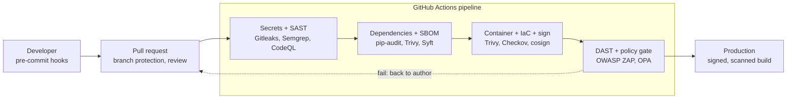

# DevSecOps Pipeline: making secure delivery a control, not a hope

> **Status: complete.** The third build in the portfolio, after the
> [AD SecOps lab](https://github.com/Amitdeb00731/secops-ad-lab) and the cloud
> identity labs on [Azure](https://github.com/Amitdeb00731/cloud-iam-lab) and
> AWS. The plan and the six phase guides are in [docs/](docs/README.md); results
> of each completed phase will appear below and in `evidence/`.

## The business problem

A bank ships code to production continuously, and the pipeline that builds and
releases it is a control surface in its own right. It decides what reaches
production, who approved it, and whether anyone can prove it afterwards. Most
incidents that begin in the software supply chain, a leaked secret in a commit, a
vulnerable dependency, an unsigned build, a missing approval, are failures of the
delivery process rather than of any one developer.

This project asks: **can a delivery pipeline enforce a bank's change and security
controls automatically, so that insecure or unapproved code cannot reach
production and every release leaves an audit trail?**

## What this lab shows

- **Change control as code:** a branch-protected repository where no change reaches
  the main branch without review, passing checks and a recorded approver, which is
  the change-management and segregation-of-duties control a bank's auditors test.
- **Shift-left security:** secrets and insecure code caught before commit and again
  in continuous integration, with static analysis on every pull request.
- **Supply-chain assurance:** dependency scanning, a software bill of materials
  (SBOM) produced and retained, and known-vulnerable dependencies flagged and
  upgraded.
- **Artefact integrity:** container images and infrastructure-as-code scanned, the
  image signed, and the signature verified in the pipeline, so what runs is the
  artefact that passed the gates.
- **A gate that blocks:** dynamic testing and a policy-as-code gate that fails the
  pipeline on a high-severity finding or a missing approval, not just a report.
- **Governance:** each control mapped to the NIST Secure Software Development
  Framework (SSDF), OWASP SAMM and its DevOps profile DSOMM, and framed against
  SOX-style IT general controls and UK operational resilience.

## Architecture



A full set of pipeline, gate and governance diagrams is in
[docs/architecture-diagrams.md](docs/architecture-diagrams.md). The plan and the
rationale are in the [Build 3 guides](docs/README.md).

## Results

Each phase is written up in its guide under `docs/`, with evidence in `evidence/`.
Each gate is built to fail a known-bad input first, then to pass once the weakness is
fixed, so the evidence shows the control working, not merely present. The Phase 6
write-ups, the pipeline security report, the controls mapping and the business
report, are in [`report/`](report/README.md).

| Phase | Focus | Status |
| --- | --- | --- |
| 1 | Pipeline and change-control foundation | Complete |
| 2 | Secrets and static analysis | Complete |
| 3 | Dependencies, SBOM and supply chain | Complete |
| 4 | Container and infrastructure-as-code security, signing | Complete |
| 5 | Dynamic testing and the policy gate | Complete |
| 6 | Report, scorecard and governance mapping | Complete |

## Repository layout

```
devsecops-pipeline/
├─ app/              the vulnerable-bank-api test application
├─ .github/workflows/ the pipeline: build, SAST, SCA, container, IaC, DAST, gate
├─ policy/           Open Policy Agent rules (Conftest)
├─ iac/              the Terraform scanned by the pipeline
├─ sbom/             retained software bills of materials
├─ docs/             the plan and the six phase guides
├─ evidence/         per-phase evidence: failing and passing runs, scans, signatures
├─ report/           pipeline security report, controls mapping, business summary
└─ lab-notes.md      the engineering log
```

## Scope and safety

The application in `app/` is a deliberately insecure test harness. Its planted
weaknesses are documented in its own README with the control each one exercises,
and the remediation commits remove them. No real secrets, personal data or
production systems are involved: the only secrets are synthetic values created for
the secret-scanning test and then removed. Everything runs free on GitHub-hosted
runners; the optional cloud deploy in Phase 5 reuses the Build 2 AWS lab under its
existing budget guardrails.

## About me

Built by **Amit Kiran Deb**, MSc graduate (results November 2026) with a
background in OT security (IEC 62443, Purdue model), aiming at cyber security and
technology risk roles in financial services.
[GitHub](https://github.com/Amitdeb00731) · [LinkedIn](https://www.linkedin.com/in/amit-deb-038b642b5/)
