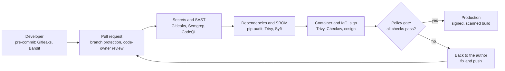
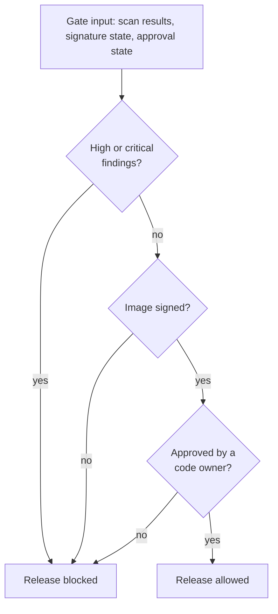
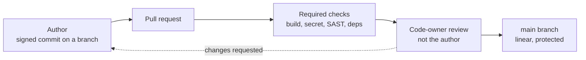
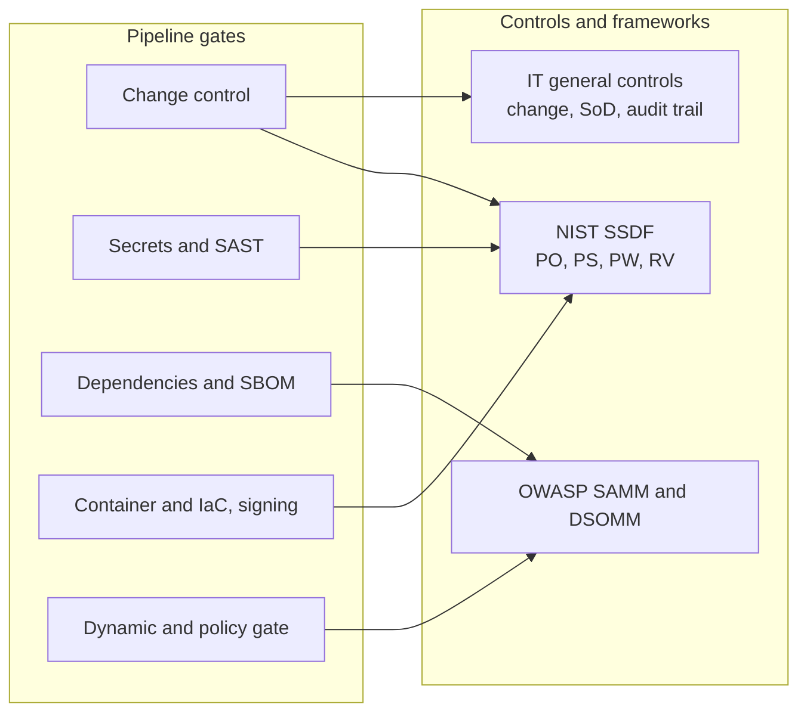

# Architecture diagrams

A high-level visual overview of the DevSecOps pipeline: the delivery flow, the gate
logic, the change-control model, and the mapping from each gate to the control it
enforces. All diagrams render natively on GitHub.

## 1. The pipeline, end to end

A change moves left to right through the gates. A failed gate sends it back to the
author; only a scanned, signed, approved build reaches production.

## 2. The gate logic

The policy gate evaluates three release criteria and any single failure blocks the
release. In this build the high or critical finding is read from the runtime test;
the signature and approval states are enforced earlier by the signing job and by
branch protection and are asserted to the gate as preconditions, as set out in the
[controls mapping](../report/controls-mapping.md).

## 3. Change control and segregation of duties

No change reaches the main branch without review, a passing build and a recorded
approver who is not the author.

## 4. Gate to control

Each gate maps to a recognised secure-development practice and an IT general
control.

