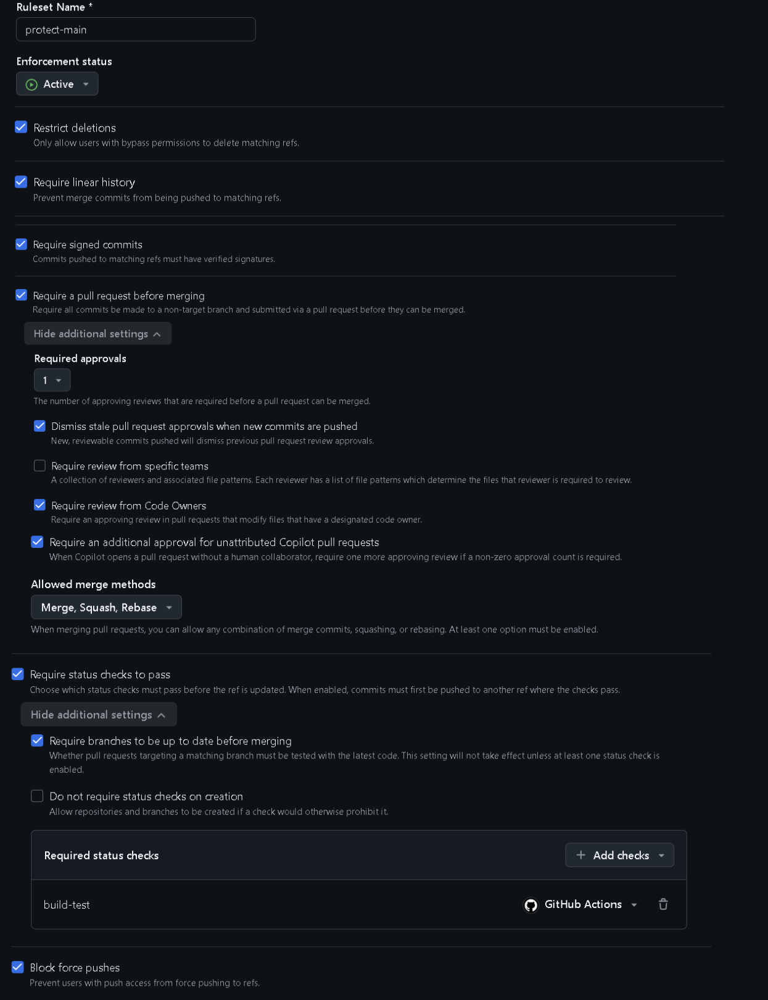
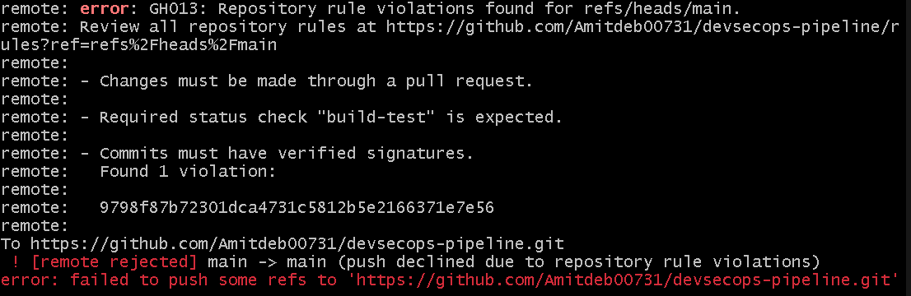
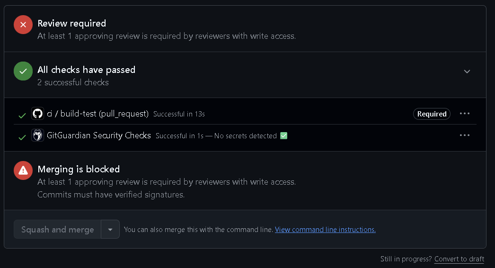
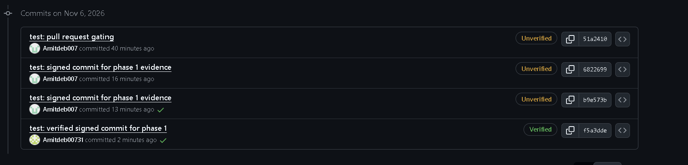
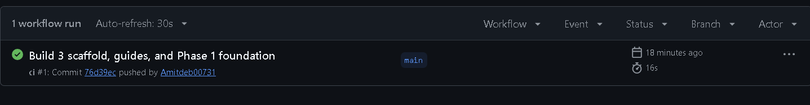

# Phase 1 evidence: pipeline and change-control foundation

The change-management and segregation-of-duties controls, shown working on the
live repository. Full write-up in [docs/01-pipeline-foundation.md](../../docs/01-pipeline-foundation.md).

## The branch-protection ruleset

The `protect-main` ruleset is Active and applies to the default branch with no
bypass, so the controls hold for everyone including the repository owner: linear
history, required signed commits, a required pull request with one approval,
dismiss stale approvals, require Code Owners, require status checks (the `build-test`
check), and block force pushes.

## A direct push to main is rejected

Pushing straight to `main` is declined by the server. The rejection names the three
controls enforced at once: changes must go through a pull request, the `build-test`
status check is required, and commits must have verified signatures.

## A pull request cannot merge without review

A pull request from a feature branch into `main` shows the required checks passing
(`ci / build-test` and the secret scan) but **Merging is blocked**: at least one
approving review is required, and commits must have verified signatures. The author
cannot approve their own pull request, which is the segregation-of-duties control.

## Commits are signed and verified

After configuring SSH commit signing and registering the key on the account, a
commit shows the green **Verified** badge. The commits made before signing was
enabled remain Unverified, which is expected and left as an honest record.

## The pipeline runs green

The baseline CI workflow builds and tests the application on every change, passing
before any security gate is added.

## Note on the solo-lab limitation

The ruleset requires one approving review and the author cannot approve their own
pull request, so in a single-person lab no pull request can be merged without an
override. This is the correct behaviour of the control; in a real team the approver
is a different person. For day-to-day work in this lab the repository owner is added
to the ruleset bypass list as the documented accommodation, while the pull request,
review and status checks still apply to the normal flow. This is recorded honestly
rather than presented as a full segregation-of-duties implementation.
