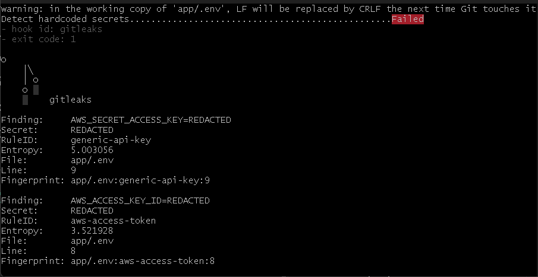
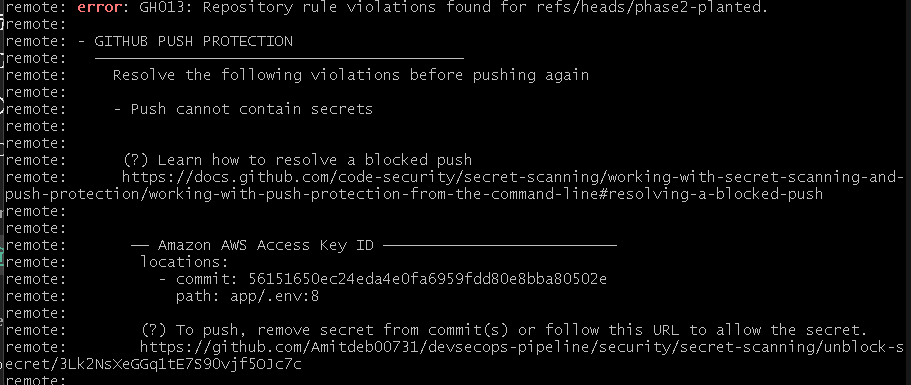
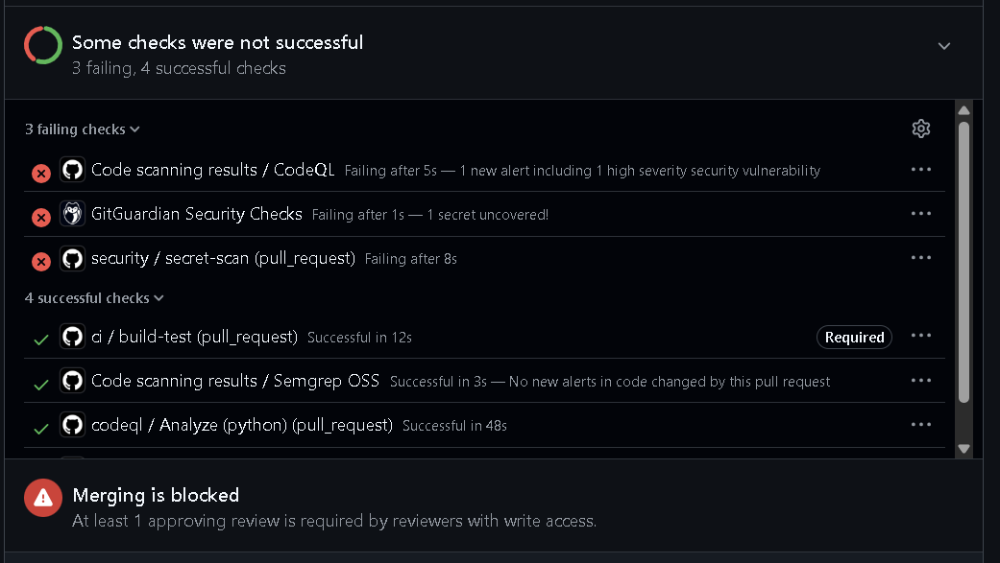
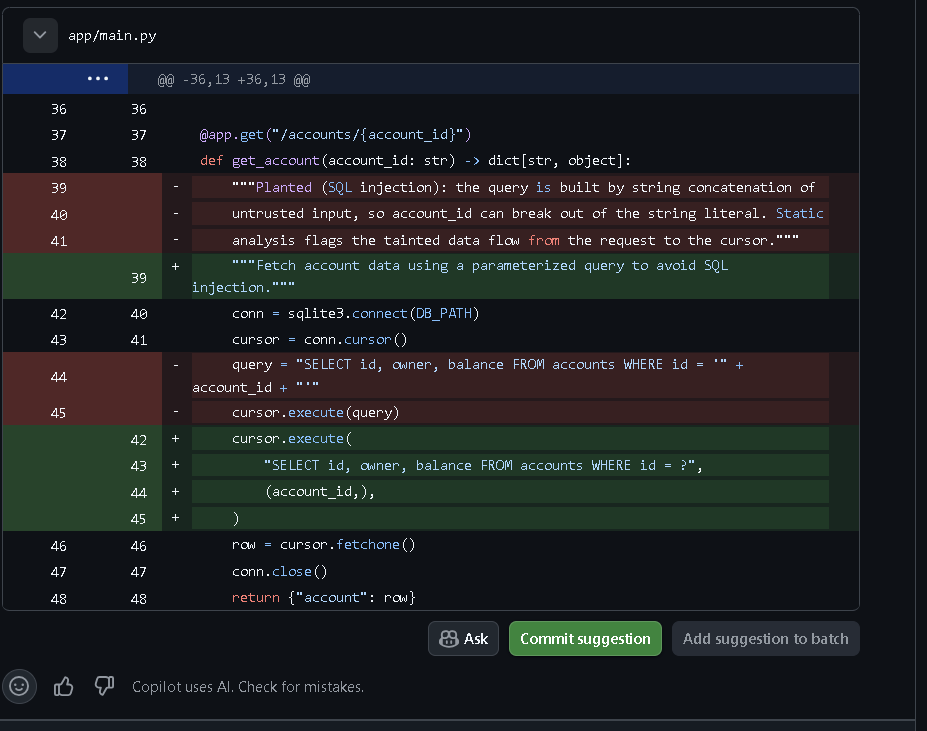
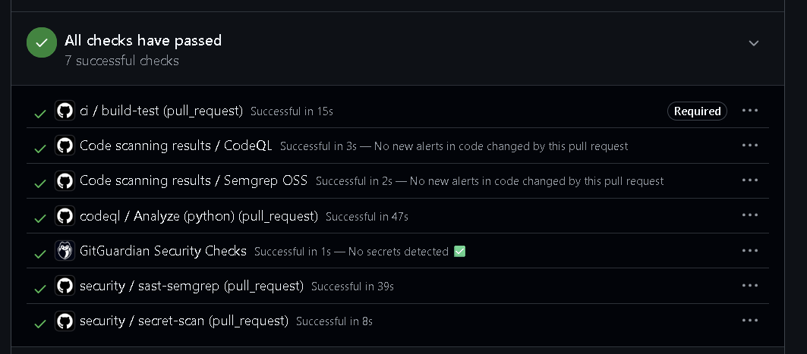

# Phase 2 evidence: secrets and static analysis

The secret-scanning and static-analysis gates, shown blocking a planted weakness
and then passing once it is fixed. Full write-up in
[docs/02-secrets-sast.md](../../docs/02-secrets-sast.md).

Each gate is proven the honest way: a deliberate, synthetic weakness is planted so
the gate fails a known-bad input first, then the weakness is fixed so the gate
passes. The planted weaknesses and the commit that removes each are documented in
[app/README.md](../../app/README.md).

## The control fires in three places

Defence in depth means a leaked secret has to get past more than one gate. Here it
was stopped at all three.

### 1. On the developer's machine, before the commit exists

The pre-commit hook runs Gitleaks on the staged change and rejects the commit. The
hook exits non-zero and names each finding: the two values in `.env` and, in the
full run, the token in `app/main.py`.

### 2. At the server, when the push is attempted

GitHub push protection recognises the AWS key formats and refuses the push with a
`GH013` rule violation, before the secret ever reaches the repository. This is the
earliest server-side gate.

Push protection catches known provider formats such as AWS keys. A generic token
that it does not recognise is left for the pipeline's own secret scanning to catch,
which is the next gate. That split is the layered-defence point made concrete.

### 3. In continuous integration, on the pull request

With the generic secret and the SQL injection still present, the pull request shows
the gates failing: `security / secret-scan` (Gitleaks) red, the CodeQL code-scanning
check red with one high-severity alert, and GitGuardian red, while `ci / build-test`
stays green because the application still builds. Merging is blocked.

CodeQL flags the SQL injection as a tainted data-flow problem, pointing at the exact
line where the query is built by string concatenation.

A note recorded honestly: Semgrep's registry rulesets did not flag this particular
raw `sqlite3` string-concatenation pattern, where CodeQL's data-flow analysis did.
That is the reason to run more than one analyser rather than trust a single tool.

## The same pull request passes after the fix

The remediation moves the token to an environment variable read at runtime and
parameterises the query. Because a secret that reached the server is treated as
compromised, it is purged from the branch history rather than deleted in a later
commit, and the synthetic value is discarded. Every check is then green, Gitleaks
and GitGuardian report no secrets, and CodeQL reports no injection.

## What is left in on purpose

The admin route with no authorisation check is not fixed in this phase. No static
analyser treats a missing authorisation check as a bug, so it is carried to the
Phase 5 dynamic test, which proves the gap by calling the route without
credentials. This is recorded in `app/README.md` as the one Phase 2 weakness still
marked for a later phase.

## Control mapping

These gates map to the NIST Secure Software Development Framework: PW.4 (reuse of
secure components, including not committing secrets), PW.7 (review code for
vulnerabilities, here by static analysis) and PW.8 (test for vulnerabilities before
release). After the passing run, `secret-scan`, `sast-semgrep` and the CodeQL check
are set as required status checks on `main`, so a secret or an injection cannot be
merged, not merely reported.
