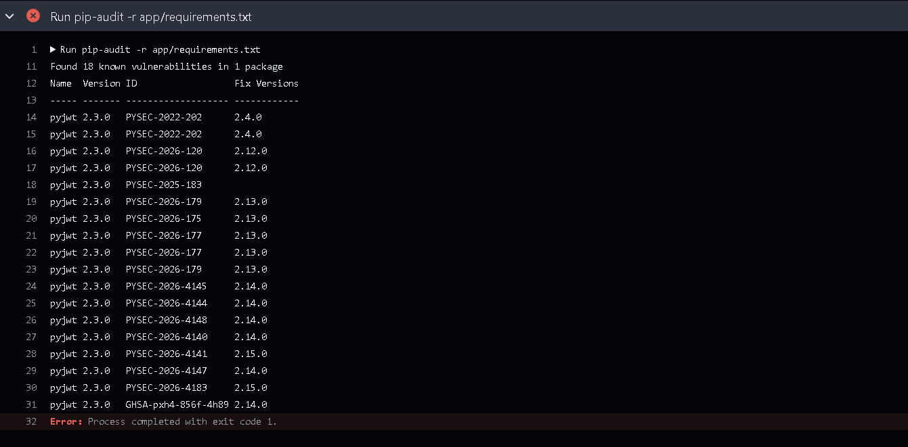
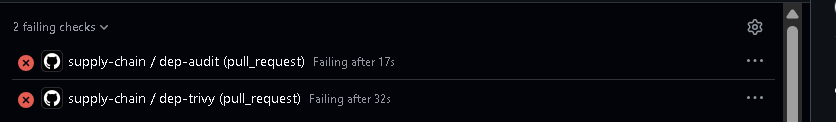
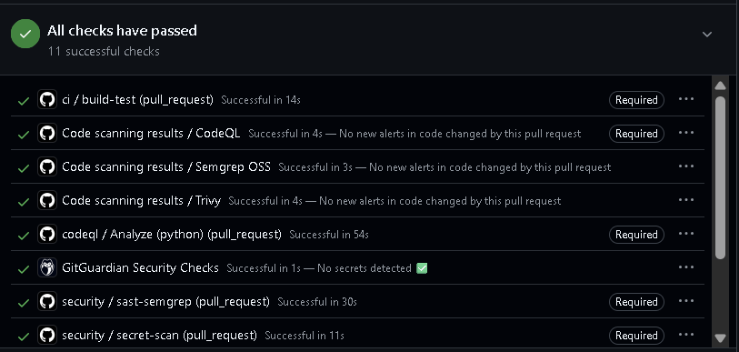
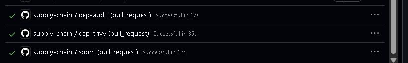

# Phase 3 evidence: dependencies, SBOM and supply chain

The dependency-scanning gate and the software bill of materials, shown flagging a
known-vulnerable dependency and then passing once it is upgraded. Full write-up in
[docs/03-dependencies-sbom.md](../../docs/03-dependencies-sbom.md).

The gate is proven the honest way: a dependency is pinned to a version with known
CVEs so the scan fails a known-bad input first, then upgraded so the scan passes.
The planted weakness and the commit that clears it are documented in
[app/README.md](../../app/README.md). Two scanners run, so a finding does not depend
on a single source: pip-audit against the Python advisory database, and Trivy in
filesystem mode.

## Before: both scanners flag the planted dependency

PyJWT was pinned to 2.3.0, which carries an algorithm-confusion flaw
(CVE-2022-29217) among others and is a natural dependency for a service that would
issue JSON Web Tokens. pip-audit reports eighteen known advisories against it, with
the fixed versions, and exits non-zero.

On the pull request, both supply-chain scanners are red while every other gate is
green. `dep-audit` and `dep-trivy` fail on the planted dependency; `sbom`,
`build-test` and the Phase 2 gates pass.

An honest detail worth recording: `dep-trivy` ran for thirty-two seconds here. An
earlier version of the job had Trivy pinned to a tag that does not exist and failed
at setup in about four seconds without ever scanning. The full-length run is the
evidence that Trivy actually downloaded its database, scanned the dependency and
caught PyJWT at HIGH severity, rather than merely reporting a red check for the
wrong reason.

## After: the upgrade clears both scanners, the SBOM is retained

The remediation upgrades PyJWT to 2.15.1, a patched release, which is the same
version Dependabot independently proposed. pip-audit then reports no known
vulnerabilities, Trivy finds nothing at HIGH or CRITICAL, and the SBOM job records
the patched inventory. Every check is green.

The retained SBOM is [`app-sbom.cdx.json`](app-sbom.cdx.json) (a copy of
[`sbom/app-sbom.cdx.json`](../../sbom/app-sbom.cdx.json)), in CycloneDX 1.6 format,
listing the patched PyJWT 2.15.1. The pipeline also uploads a freshly generated SBOM
as a build artefact on every run, so each build has a recorded inventory of what it
contains.

## Dependabot: the ongoing control

The one-off scan proves the gate at a point in time; Dependabot is the control that
keeps it true. With [`.github/dependabot.yml`](../../.github/dependabot.yml) in
place, Dependabot raised pull requests on its own: to upgrade the vulnerable PyJWT
to 2.15.1, and to bump the pipeline's own Actions. That covers both the
application's dependencies and the pipeline's own supply chain.

## Fix and lesson

The Trivy job was first pinned to `aquasecurity/trivy-action@0.24.0`. That tag does
not exist, the action's tags are `v`-prefixed, so the job failed to resolve the
action and never ran. Corrected to `@v0.36.0`, the version the action's own README
recommends. The lesson, recorded in the lab notes: a red check is not proof until
you confirm it failed for the reason you intended, not on a broken configuration.

## Control mapping

These gates map to the NIST Secure Software Development Framework: PW.4 (use
well-secured components and track them) and RV.1 (identify and confirm
vulnerabilities on an ongoing basis), and to the OWASP SAMM Supply Chain practice.
After the passing run, `supply-chain / dep-audit` and `supply-chain / dep-trivy` are
set as required status checks on `main`, so a known-vulnerable dependency cannot be
merged, not merely reported.
