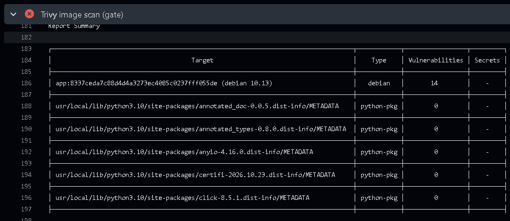
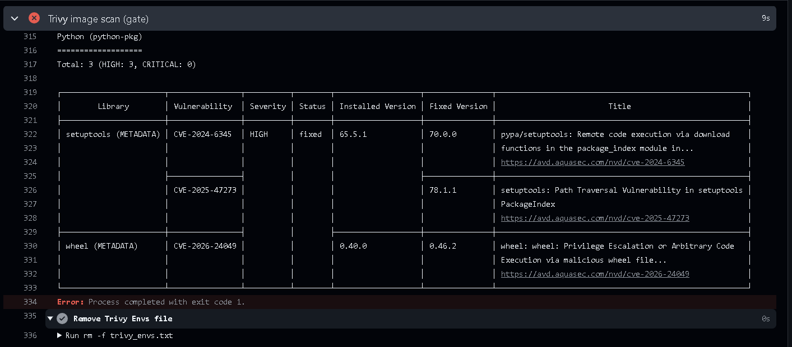
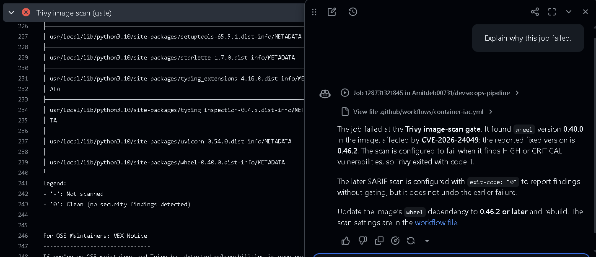
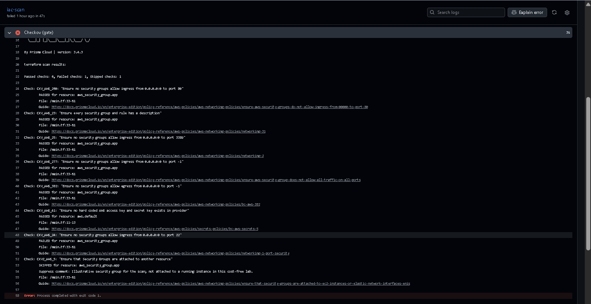
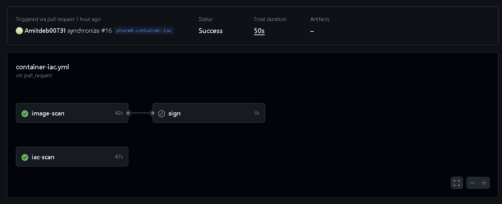
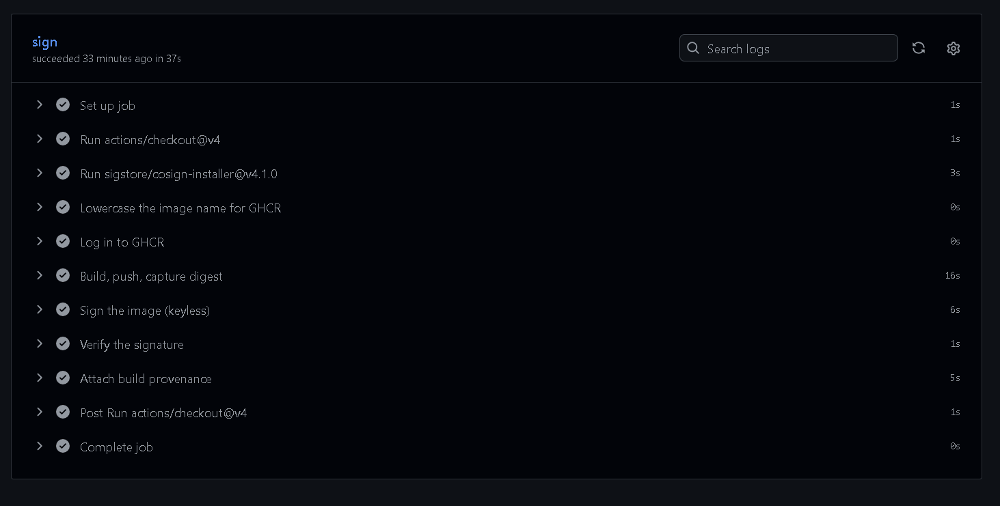
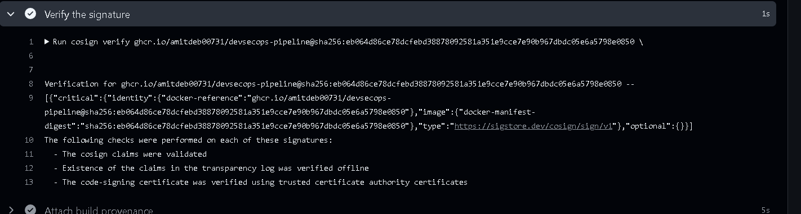
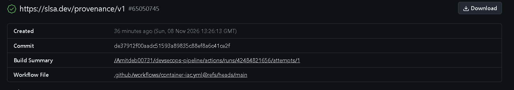
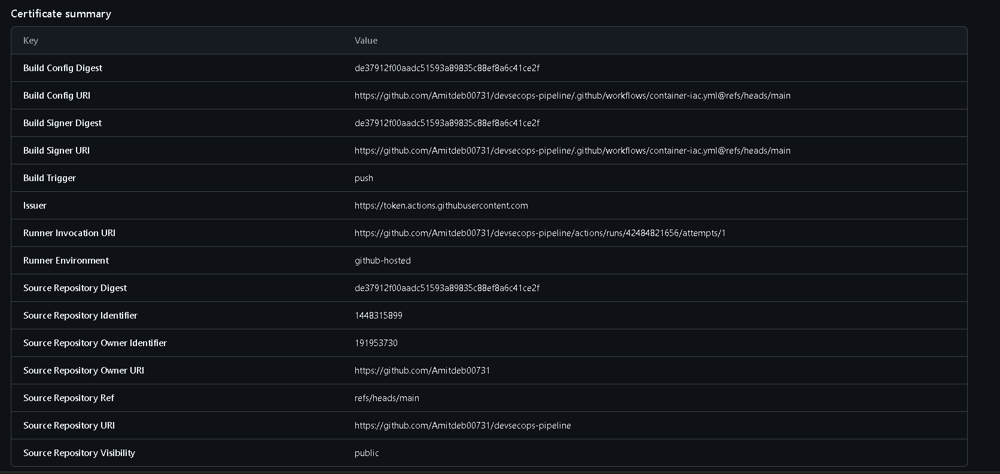

# Phase 4 evidence: container and infrastructure-as-code security, signing

The container image scan and the infrastructure-as-code scan, shown failing on a
planted weakness and then passing once it is fixed, and the released image signed
and its provenance recorded. Full write-up in
[docs/04-container-iac.md](../../docs/04-container-iac.md).

The gates are proven the honest way: a weak Dockerfile and an over-permissive
Terraform rule are planted so each scan fails a known-bad input first, then fixed so
it passes. The planted weaknesses and the commits that clear them are documented in
[app/README.md](../../app/README.md). Each state below was confirmed from the
GitHub Actions run logs, not from the green tick alone.

Three jobs run in [`.github/workflows/container-iac.yml`](../../.github/workflows/container-iac.yml):

- `image-scan`: builds the image and scans it with Trivy; a HIGH or CRITICAL finding
  that has a fix available fails the job, so the scan is a gate.
- `iac-scan`: Checkov is the blocking gate over the Terraform in `iac/`; Trivy in
  config mode runs as a second, report-only scanner to the security tab. tfsec is
  deprecated and folded into Trivy, so it is not used.
- `sign`: on the push to `main` only, pushes the image to GHCR, signs it keylessly
  with cosign using the workflow's OIDC identity, verifies the signature, and
  attaches SLSA build provenance.

## Before: both scans flag the planted weaknesses

The planted Dockerfile uses an end-of-life Debian base and runs as root. Trivy's
report summary shows the base, `debian 10.13`, carrying fourteen HIGH
operating-system vulnerabilities.

The Python section adds three more HIGH findings in the base build tooling, and the
gate exits with code 1, so `image-scan` fails.

GitHub's own "Explain why this job failed" summary reads the same run and reaches the
same conclusion in plain language: the image-scan gate failed because the image
carried a HIGH vulnerability with a fix available, so Trivy exited non-zero.

The planted Terraform opens the management port (22) to `0.0.0.0/0`. Checkov fails
`CKV_AWS_24` (security group allows ingress from the whole internet to a sensitive
port) and exits non-zero, so the `iac-scan` gate fails.

An honest detail worth recording: the very first planted base, `python:3.9-slim-buster`,
could not even build, because FastAPI 0.162 requires Python 3.10 or newer, so pip
found no matching distribution and Trivy errored with no image to scan. That is a
red check for the wrong reason. The base was corrected to `python:3.10-slim-buster`,
which builds but is genuinely vulnerable, so the scan actually ran and caught the
real findings above.

## After: the fixes clear both gates

The remediation hardens the image and the infrastructure:

- **Image** ([app/Dockerfile](../../app/Dockerfile)): a digest-pinned
  `python:3.12-slim-bookworm` base, a dedicated non-root user (`appuser`, uid 10001),
  the build tooling upgraded to patched versions, and a [.dockerignore](../../.dockerignore)
  that keeps caches, tests and the synthetic `.env` out of the build context. Trivy
  then finds nothing at HIGH or CRITICAL and the gate passes.
- **Infrastructure** ([iac/main.tf](../../iac/main.tf)): the ingress rule is
  restricted to a single trusted admin CIDR variable instead of the whole internet,
  and Checkov passes.

## The image is signed and its provenance recorded

On the merge to `main`, the `sign` job pushed the image to GHCR, signed it keylessly
with cosign (no private key is stored; the signing identity is the workflow itself
via GitHub OIDC), and verified the signature in the same run. `cosign verify` passed
all three of its checks against the expected identity and issuer. The full verify
output and the provenance pointers are captured in
[signature-verification.txt](signature-verification.txt).

Every step of the `sign` job on the merge to `main` passed: build and push, keyless
sign, verify, and attach provenance.

The verify step confirms the signature against the workflow identity and the GitHub
Actions issuer, with all three cosign checks passing.

Build provenance was attached with `actions/attest-build-provenance`: a SLSA v1
predicate tying the image digest to the source commit and the workflow that built
it, recorded in the Rekor transparency log, on the repository's
[Attestations](https://github.com/Amitdeb00731/devsecops-pipeline/attestations) page
and pushed to GHCR alongside the signature.

The attestation's certificate summary records the keyless identity behind it: the
build and signer URIs are the `container-iac.yml` workflow at `refs/heads/main`, the
issuer is the GitHub Actions OIDC token service, and the source commit and repository
are named. The raw Sigstore bundle is retained as
[attestation-65050745.sigstore.json](attestation-65050745.sigstore.json).

Because the signature is bound to the `container-iac.yml` workflow identity and the
GitHub Actions OIDC issuer, verification succeeds only for the image this pipeline
built and signed. An unsigned image, or one signed by any other identity, fails the
same `cosign verify`, which is what makes the signature a usable integrity control
rather than a label.

## Fixes and lessons

- **A planted base must build, or the scan never runs.** `python:3.9-slim-buster`
  failed the build (FastAPI needs Python 3.10+), so Trivy had no image and errored.
  A red check is only evidence once you confirm it failed for the reason you
  intended.
- **A scanner's third-party SBOM can produce a false positive.** Trivy kept
  reporting `setuptools` 70.3.0 (CVE-2025-47273) after the installed version was
  patched, because it also reads pip's bundled CycloneDX SBOM
  (`pip/_vendor/bom.cdx.json`), which lists pip's stripped-down vendored setuptools
  regardless of what is installed. Deleting that bundled SBOM in the build makes the
  scan reflect the packages actually present. Trivy's own "third-party SBOM may lead
  to inaccurate detection" warning is the signal.
- **GHCR denies a provenance-attested index on first push.** The push failed with
  `denied` after every layer uploaded, because BuildKit attaches a provenance
  attestation by default and the resulting OCI index is rejected on the first push
  to a new package. Building a single plain manifest
  (`docker buildx build --provenance=false --sbom=false --load`) fixes it; provenance
  is still attached separately by the attest step.

## Control mapping

These controls map to the NIST Secure Software Development Framework: PW.4 and PW.9
(well-secured components and a secure-by-default configuration, here the hardened,
non-root, digest-pinned image), RV.1 (identify vulnerabilities on an ongoing basis,
the image and IaC scans), and PS.2 and PS.3 (provide a mechanism to verify software
integrity and to archive and protect each release, here the cosign signature and the
SLSA provenance). They map to the OWASP SAMM Operations business function, in
particular Environment Management and Operational Management. After the passing run,
`container-iac / image-scan` and `container-iac / iac-scan` are set as required
status checks on `main`, so a vulnerable image or an over-permissive rule cannot be
merged, not merely reported.
