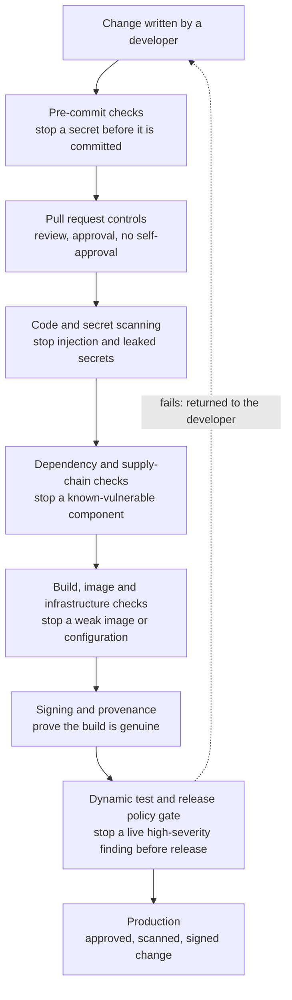

# Business report: secure delivery as a control

This report is written for a business and risk audience. It explains, without
reference to the implementation detail, what risk this pipeline addresses, how it
addresses it, and how that maps to the regulatory expectations a UK bank operates
under. The technical record is in the
[pipeline security report](pipeline-security-report.md) and the
[controls mapping](controls-mapping.md).

## The business problem

A bank ships software to production continuously. The pipeline that builds and
releases that software decides what reaches production, who approved it, and whether
anyone can prove it afterwards. Most incidents that begin in the software supply chain
are failures of that delivery process rather than of any one developer: a secret
committed by mistake, a dependency with a known flaw, an unsigned build, or a change
that reached production without the right approval.

If an insecure or unapproved change reaches a customer-facing service, the
consequences are a service outage, exposure of customer data, fraud, a regulatory
breach, and a loss of customer trust. The control question is therefore simple: can
the delivery process itself prevent that, automatically, and leave an audit trail?

## What the pipeline does

The pipeline places a series of gates between a developer's change and production.
Each gate enforces one control, and a change that fails any gate is stopped rather
than merely flagged. The gates run in layers, so a single mistake has to pass more
than one independent check to reach production.

The result is that security and approval are properties of the delivery process, not
of any one person remembering to check. Every change that reaches production has been
reviewed by someone other than its author, scanned for secrets, insecure code,
vulnerable dependencies and weak configuration, built into a signed artefact whose
origin can be verified, and tested at runtime against a policy that blocks the release
if a serious finding is present.

## How this maps to regulatory expectations

### UK operational resilience (PRA and FCA)

The PRA and FCA require firms to identify their important business services, set
impact tolerances for disruption, and put controls in place to remain within those
tolerances and to learn from incidents. A delivery pipeline that prevents an insecure
or unapproved change from reaching a service is a preventative control supporting
operational resilience: it reduces the likelihood of a self-inflicted disruption from
a faulty or malicious change. The audit trail the pipeline produces, the reviews, the
signed commits, the retained inventories and the signed artefacts, supports the
expectation that a firm can evidence its controls and reconstruct what happened after
an event.

### SOX-style IT general controls

For systems that are relevant to financial reporting, the controls that matter to an
auditor are change management, access and segregation of duties, and a reliable audit
trail. This pipeline implements each of those as an automated, evidenced control:
changes cannot reach production without approval, the author of a change is not its
approver, and every step leaves a record. Making these controls automatic rather than
manual is what gives assurance that they operate consistently on every change.

## Control summary for a business reader

| Risk to the service | Control in the pipeline | State |
| --- | --- | --- |
| An unapproved change reaches production | Mandatory review and approval before release | In place |
| A developer approves their own change | Separate approver required; self-approval blocked | In place, with a lab limitation |
| A secret is leaked into the code | Secret scanning at three points | In place |
| Insecure code ships | Static and dynamic security testing | In place |
| A vulnerable third-party component ships | Dependency scanning and an upgrade process | In place |
| A tampered or unverifiable build ships | Signing and provenance | In place |
| A serious finding is reported but shipped anyway | A policy gate that blocks the release | In place |

## Honest statement of scope

This is a demonstration build on a single service, run by one person on free,
publicly hosted infrastructure. It shows how the controls are designed and that they
operate; it is not an audit or a certification, and the single-person setup means the
segregation-of-duties control proves the mechanism rather than the separate people a
real team provides. The limitation is documented rather than hidden. The value of the
build is that it makes secure, approved delivery a property of the process, which is
the control objective a bank's risk and audit functions are asking to see.
